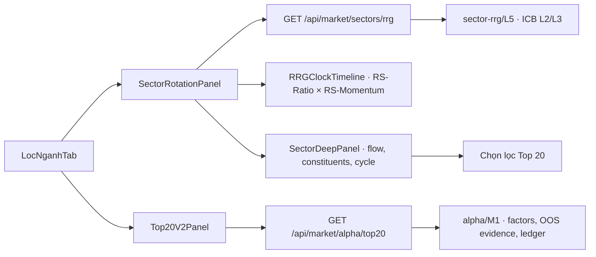

# Rà soát RRG ngành, Top 20 và lộ trình 4D

**Phạm vi:** tab Lọc ngành → Xoay vòng ngành ICB, RRG tuần và Radar Top 20 v2.  
**Ngày rà soát:** 27/10/2026.  
**Trạng thái:** rà soát mã nguồn và tích hợp mở rộng 4D nghiên cứu; chưa phải xác nhận mô hình có alpha giao dịch.

## 1. Tóm tắt bàn giao

Global Quanta đã có nền RRG ngành tốt hơn đoạn mẫu đính kèm: chỉ số ngành được dựng từ giá điều chỉnh, tái cân bằng có giới hạn trọng số; RRG tuần dùng RS-Ratio/RS-Momentum kiểu JdK; tuần chưa đóng được tách khỏi góc phần tư đã đóng; mã được nhóm theo ICB; dòng tiền/ngành và Top 20 có evidence riêng.

Đường hiện có: chọn ngành trên RRG hoặc bảng Xoay vòng ngành → mở chi tiết → lọc Top 20. Top 20 v2 là chế độ mặc định, có 18 yếu tố và ledger chấm sau 21 phiên; kiểm định đặt trước đang ghi rõ EXPERIMENTAL/không đạt. RRG cũng không được mặc định coi là tín hiệu đạt kiểm định.

Đã nối bổ sung 4D nghiên cứu bằng dữ liệu Gateway thật:

- **X/Y:** RS-Ratio và RS-Momentum tuần đã có.
- **Z:** z-score lịch sử của thị phần giá trị giao dịch ngành, dùng flow.share.z hiện có.
- **W/màu:** Pearson correlation của lợi suất ngày ngành với VN-Index trên tối đa 60 phiên ghép cặp; cần ít nhất 30 quan sát.

Bản đồ được chiếu thành SVG 3D nhẹ, không cần WebGL hoặc dependency mới. RRG 2D chuẩn giữ nguyên; bản đồ 4D là tùy chọn. Thiếu dữ liệu thì không dựng điểm giả.

## 2. Kiểm kê đường đi hiện hữu

### Xoay vòng ngành

- Backend: backend/src/market/sectors/sectorRotation.js, route GET /api/market/sectors/rrg.
- Universe ICB cấp 2 và cấp 3; chỉ số ngành theo giá điều chỉnh, tỷ trọng giá trị giao dịch có trần, tái cân bằng định kỳ.
- RRG theo tuần đã đóng dùng VN-Index làm benchmark; có hysteresis giảm đổi góc phần tư do nhiễu.
- Snapshot có dataAsOf, closedThrough, partialWeek, coverage/missing, phương pháp và evidence.
- UI có FlowMap, đồng hồ RRG vệt 12 tuần, bảng ngành, SectorDeepPanel và đường mở bộ lọc Top 20.

### Top 20

- Mặc định là Top20V2Panel, lấy /api/market/alpha/top20; mô hình M1 dùng factor giá/dòng tiền/cơ bản/ngành, evidence T3 và ledger.
- Bảng confluence cũ còn là nhánh tùy chọn riêng; không nên trộn score/weight của hai engine.
- T2/T3 evidence hiện được UI mô tả là chưa đạt/experimental. Điểm cao không đồng nghĩa xác suất sinh lời.
- Top 20 chỉ có mã ngành cấp 2; chọn ngành cấp 3 trước nâng cấp có nguy cơ lọc rỗng gây hiểu nhầm.

## 3. Đánh giá ưu/nhược điểm và lỗ hổng

| Mảng | Điểm mạnh | Khoảng trống/rủi ro | Ưu tiên |
|---|---|---|---|
| RRG 2D | Công thức/benchmark/horizon được mô tả; tuần đóng và tuần hiện tại phân biệt; có lịch sử và coverage | Chưa thể hiện chiều dòng tiền hoặc tương quan trên cùng snapshot; cần làm rõ freshness | P1 |
| Flow và breadth ngành | Share, CMF, accumulation/distribution, breadth và leaders trong drill-down | Dễ coi heuristic là forecast; các yếu tố tương quan có thể bị đếm nhiều lần | P1 |
| Top 20 v2 | 18 yếu tố, decomposition, evidence/OOS, cap theo ngành và ledger | Snapshot dựng theo lịch; thiếu refresh rõ; cấp 3 không khớp granularity payload cấp 2 | P1 |
| Tích hợp RRG → Top20 | Có đường điều hướng và filter theo ngành cấp 2 | Phạm vi lọc cấp 3 trước đây không được giải thích | P1 |
| Đoạn code 4D đính kèm | Đề xuất mã hóa thêm thông tin trực quan | Tạo dữ liệu ngẫu nhiên; RS là tỷ số hai lợi suất có thể gần zero; W gọi là correlation nhưng thật ra nghịch đảo volatility; z/risk tùy ý; localStorage không phải lịch sử server; useMemo sau nhánh return vi phạm hook order; shader/geometry và chuỗi HSL có lỗi; Three.js tăng bundle nếu không lazy-load | Không dùng nguyên mẫu |

## 4. Điều chỉnh đã tích hợp

### 4.1 Chiều W từ dữ liệu quan sát

rollingMarketCorrelation() ghép ngày giao dịch chỉ số ngành và VN-Index, đổi thành lợi suất ngày, rồi tính Pearson trên tối đa 60 cặp gần nhất. Dưới 30 cặp, phương sai bằng 0 hoặc dữ liệu không khớp thì trả null kèm trạng thái; không thay bằng 0. Tương quan tính trên lợi suất, không tính trên mức giá có xu hướng.

rrg4d được thêm theo hướng optional/additive vào snapshot sector. Client cũ có thể bỏ qua field mới; thiếu field không làm hỏng bảng hiện hành.

### 4.2 Bản đồ 4D nghiên cứu

RRG4DProjection giữ RS-Ratio/RS-Momentum làm hai trục chuẩn; Z là z-score thị phần GTGD; màu mã hóa correlation. Click/Enter/Space trên điểm mở chi tiết ngành. Bản đồ có trạng thái thiếu lịch sử và mô tả accessible. Không gắn nhãn risk, energy hoặc probability từ các thang điểm tự đặt.

### 4.3 Top 20 và cập nhật

- Top 20 v2 có thao tác làm mới và thời điểm snapshot.
- Query confluence legacy chỉ chạy khi người dùng chọn chế độ đó.
- RRG có chu kỳ revalidate và nút refresh riêng.
- Khi chọn ngành ICB cấp 3, Top 20 lọc theo ngành cấp 2 cha và ghi rõ đây là lọc theo granularity endpoint hiện có; không tuyên bố lọc chính xác cấp 3.

## 5. Định nghĩa 4D và giới hạn

Đây là bốn biến thị trường, không phải bốn trục hình học Euclidean. Ba biến được chiếu vào không gian 3D; biến thứ tư được mã hóa bằng màu:

| Biến | Định nghĩa | Đơn vị/miền | Hạn chế |
|---|---|---|---|
| X | RS-Ratio tuần JdK so VN-Index | 100 ± z-score | Theo định nghĩa/window của RRG engine |
| Y | RS-Momentum tuần JdK | 100 ± z-score | Snapshot tuần đóng; không phải tín hiệu ngày |
| Z | Z-score lịch sử của thị phần GTGD ngành | z-score share 20/60 so lịch sử 250 phiên | Bất thường thị phần, không phải raw volume momentum |
| W | Pearson correlation lợi suất ngành–VN-Index | [−1, 1], tối đa 60 cặp, tối thiểu 30 | Quan hệ tuyến tính theo cửa sổ; không phải beta, causal effect hay mức rủi ro |

Không đổi W thành “độc lập/an toàn”. Correlation gần 0 không bảo đảm diversification trong tail events. Beta và idiosyncratic volatility phải được tính riêng và mang đúng nhãn.

## 6. Lộ trình hoàn thiện 4D chuyên nghiệp

### P0 — Hợp đồng và tái lập
1. Phiên bản hóa schema/method; snapshot chứa benchmark, asOf, receivedAt, window, n, status và config hash.
2. Đồng bộ ngày kết thúc X/Y/Z/W hoặc hiển thị ngày riêng cho từng chiều.
3. Chốt cadence dựng snapshot và freshness; expose freshness trên UI.
4. Lưu fixture server-side gồm null/partial/low coverage.

### P1 — Chuỗi thời gian 4D
1. Persist mỗi điểm tuần đã đóng trong KV append-only, có schema/method version.
2. Tạo trailing path đồng bộ X/Y/Z/W; không dùng localStorage thay lịch sử.
3. Giữ universe, benchmark, adjusted-price basis, ngày kết thúc và min sample nhất quán.
4. Late data/corrections tạo revision mới, không sửa im lặng snapshot forecast cũ.

### P2 — Phân tích tương tác
1. Timeline scrubber theo tuần, play/pause có reduced-motion; bật/tắt trail.
2. Filter ngành, universe, quadrant, correlation band và flow-share anomaly; đồng bộ sector table, deep panel và Top20.
3. Camera 3D chỉ là lựa chọn; mặc định orthographic 2D/2.5D để giữ label, keyboard, mobile và hiệu năng.
4. Có accessible table tương đương; không dựa vào màu, hover hoặc WebGL.
5. Lazy-load WebGL renderer nếu có; fallback SVG khi mất WebGL context.

### P3 — Bằng chứng định lượng
1. Đăng ký trước target, ví dụ sector excess return sau phí trong 5/20 phiên; quadrant không tự làm target.
2. Temporal split theo ngày, purge/embargo cho nhãn chồng lấn, benchmark đơn giản và placebo.
3. Đo Rank IC, top-minus-bottom spread, turnover, drawdown, capacity, net-of-cost, confidence interval và stability theo regime.
4. Báo cáo multiple-testing/Deflated Sharpe; walk-forward và shadow trước khi nâng nhãn.
5. Xác suất phải gắn target/horizon và calibration; không chuyển sector state/RRG color thành probability.

### P4 — Vận hành
- Metrics: freshness từng chiều, coverage n, correlation null rate, schema error, render time và interaction errors.
- Feature flag cho 4D; rollout nội bộ trước, rollback về RRG 2D không mất dữ liệu.
- Alert có owner khi index/benchmark lệch ngày, correlation mất coverage hoặc ledger bỏ snapshot.

## 7. Tiêu chí nghiệm thu

### Dữ liệu và phương pháp
- [ ] Không có dữ liệu ngẫu nhiên/mock ở production.
- [ ] X/Y truy nguyên về RRG weekly engine; Z/W có công thức, kỳ, n và as-of.
- [ ] W tính trên returns ghép đúng ngày; n < 30, zero variance hoặc missing trả null và lý do.
- [ ] Partial week không được trình bày như tuần đóng; các chiều đồng bộ hoặc nêu ngày riêng.
- [ ] Không gọi correlation là risk, probability, safety hoặc guarantee diversification.

### UX và tích hợp
- [ ] RRG 2D vẫn hoạt động khi 4D thiếu/lỗi; 4D có toggle/insufficient state.
- [ ] Click điểm ngành mở đúng SectorDeepPanel; Top20 ghi đúng granularity lọc.
- [ ] Top20 hiển thị engine, as-of, evidence và refresh state; legacy/v2 không cộng điểm chéo.
- [ ] Bản đồ dùng được bằng bàn phím, có mô tả accessible và không dựa vào màu duy nhất.
- [ ] Không thêm WebGL mặc định trước khi đo hiệu năng và chuẩn bị fallback.

### Model governance
- [ ] Giữ nhãn EXPERIMENTAL/evidence hiện tại cho tới khi owner phê duyệt.
- [ ] Backtest có temporal OOS, phí, turnover/capacity, placebo và khoảng tin cậy.
- [ ] Không biến thứ hạng ngành thành khuyến nghị hoặc xác suất sinh lời.

## 8. File liên quan
- Frontend RRG: src/components/MainTabs/LocNganh/timing/SectorRotationPanel.tsx, RRGClockTimeline.tsx, RRG4DProjection.tsx.
- Frontend Top20: src/components/MainTabs/LocNganh/LocNganhTab.tsx, Top20V2Panel.tsx.
- Hooks/contracts: src/hooks/useSectorRotation.ts, useAlphaTop20.ts, useTop20Radar.ts, src/lib/locnganh/types.ts.
- Backend: backend/src/market/sectors/sectorRotation.js, backend/src/routes/market.js.
- Top20 model/evidence: backend/src/market/alpha/alphaService.js, src/types/alphaTop20.ts.

