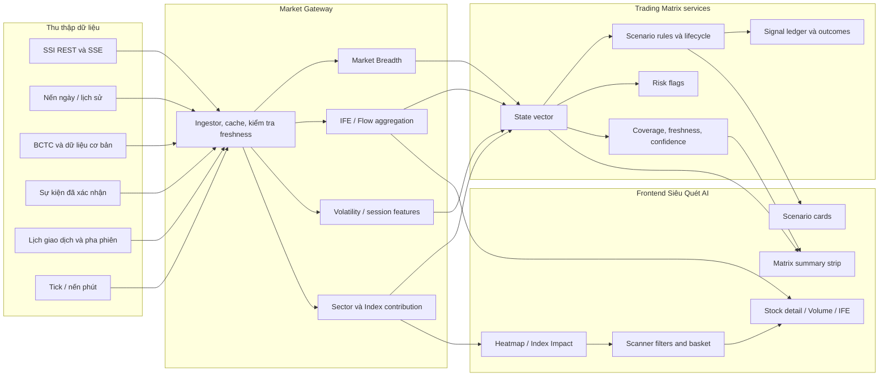
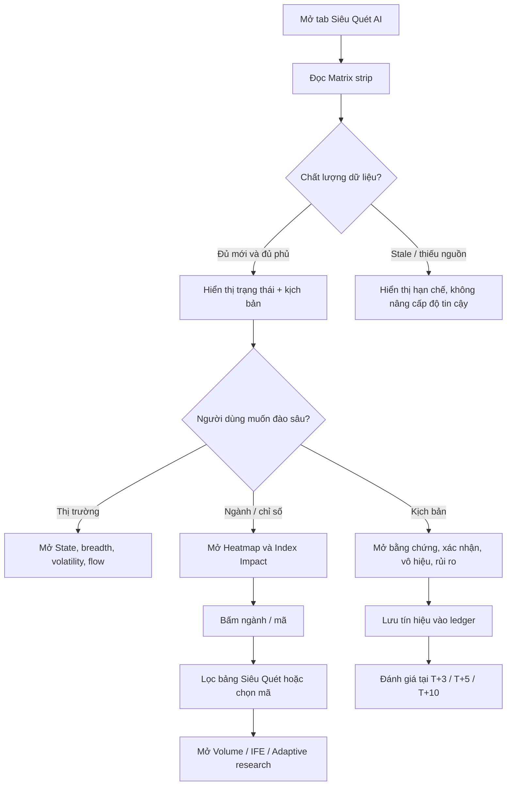

# Trading Matrix — Đặc tả tích hợp vào tab Siêu Quét AI

**Phiên bản:** 1.0  
**Trạng thái:** Đề xuất kiến trúc và kế hoạch triển khai  
**Ngày:** 22/10/2026  
**Phạm vi:** Frontend tab Siêu Quét AI, Market Gateway, dữ liệu nghiên cứu, kiểm định tín hiệu và vận hành  
**Nguyên tắc:** Tài liệu thiết kế; không thay đổi mã nguồn hay cấu hình dự án.

---

## 1. Tóm tắt điều hành

Trading Matrix được thiết kế như một **lớp tổng hợp và điều hướng quyết định**, đặt giữa dải VN-Index và bảng mã Siêu Quét. Nó giúp người dùng trả lời theo thứ tự:

1. Thị trường hiện ở trạng thái nào, trên khung thời gian nào?
2. Tín hiệu được tạo từ dữ liệu gì, dữ liệu có đủ mới và đủ phủ không?
3. Các nhóm ngành/mã nào đang thuận hoặc nghịch với trạng thái đó?
4. Kịch bản nào đang được theo dõi, điều kiện nào xác nhận hoặc làm kịch bản mất hiệu lực?
5. Rủi ro nào cần kiểm tra trước khi người dùng lập kế hoạch giao dịch?

Ma trận **không phải một mô hình dự báo đơn khối**, không tự phát lệnh và không tự quyết định tỷ trọng vốn. Nó kết hợp các nguồn hiện có: dữ liệu SSI/Gateway, Market Breadth, trạng thái VN-Index, Market Impulse, IFE/Intent Footprint, khối ngoại, phân ngành, sự kiện đã xác nhận và thống kê nghiên cứu. Mỗi nguồn giữ định nghĩa riêng, thời điểm riêng và chỉ báo chất lượng riêng.

### Quyết định thiết kế chính

- Thêm một vùng **Trading Matrix** có thể thu gọn ngay dưới `VnIndexBand`, phía trên bảng Siêu Quét/Bảng giá.
- Mặc định hiển thị một dải tóm tắt gọn. Heatmap, Index Impact, bằng chứng kịch bản và checklist rủi ro chỉ hiện khi mở rộng.
- Không gộp mọi dữ liệu thành một “điểm AI” duy nhất. Hiển thị trạng thái, xác suất đã hiệu chỉnh nếu đủ điều kiện, độ phủ, độ mới, bằng chứng ủng hộ và bằng chứng mâu thuẫn.
- Tái sử dụng nghiên cứu HMM/Bayes, IFE, vòng phản hồi và bộ tinh chỉnh hiện hữu. Chỉ bổ sung mô hình mới khi chứng minh có lợi thế ngoài mẫu.
- Đưa các luật ngưỡng mới vào chế độ **shadow** trước khi chúng tác động tới giao diện hành động.
- Mọi cờ rủi ro là thông tin hỗ trợ kiểm tra; không phải lệnh mua/bán hoặc cam kết kết quả.

---

## 2. Mục tiêu, phạm vi và tiêu chí thành công

### 2.1 Mục tiêu người dùng

- Đọc trạng thái thị trường trong vài giây mà không phải mở nhiều tab.
- Đi từ bối cảnh chỉ số → ngành → mã → phân tích chi tiết bằng một luồng thao tác liên tục.
- Nhận biết rõ tín hiệu nào là dữ liệu trực tiếp, dữ liệu cuối phiên, dữ liệu ước tính hoặc dữ liệu thiếu.
- Hiểu được tại sao một kịch bản được bật và điều gì sẽ làm nó sai.
- Kiểm tra rủi ro trước khi tự lập kế hoạch, thay vì nhận một khuyến nghị giải ngân thiếu bối cảnh.

### 2.2 Phạm vi tính năng

1. Tổng hợp trạng thái thị trường đa khung.
2. Độ rộng thị trường và mức phân hóa.
3. Biến động, pha phiên và thanh khoản.
4. Dòng tiền theo nguồn và chất lượng ước lượng.
5. Kịch bản thị trường có điều kiện xác nhận/vô hiệu.
6. Bảng tác động VN-Index và heatmap ngành.
7. Cờ rủi ro và checklist kế hoạch.
8. Liên kết tương tác với rổ, lọc ngành, danh mục, dòng phụ và Action Center/Radar.
9. Lưu snapshot, ghi nhận tín hiệu và đánh giá hiệu suất ngoài mẫu.

### 2.3 Ngoài phạm vi phiên bản đầu

- Tự đặt lệnh hoặc kết nối đường thực thi lệnh.
- Tự phân bổ 80–100% vốn hoặc áp đặt tỷ lệ vốn cố định.
- Nhận dạng “tổ chức”, tài khoản lớn hoặc cụm stop-loss khi nguồn không cung cấp danh tính/dữ liệu lịch sử đáng tin cậy.
- Khẳng định các thống kê hiệu suất trong tài liệu ý tưởng là kết quả đã tái lập.
- Thêm LSTM, Transformer hoặc XGBoost chỉ vì chúng có tên trong đề xuất; mô hình chỉ được thêm khi có kiểm định chứng minh lợi ích tăng thêm.

### 2.4 Tiêu chí thành công cấp sản phẩm

- Người dùng xác định được trạng thái chính, độ mới và mức phủ dữ liệu mà không cần mở tooltip.
- Một thao tác từ Heatmap hoặc Index Impact có thể lọc bảng mã đến đúng tập cổ phiếu.
- Tín hiệu không biến mất hoặc đổi hướng chỉ vì mã ngoài viewport không còn được stream.
- Khi nguồn bị lỗi hoặc stale, giao diện đổi sang trạng thái rõ ràng; không trình bày “không có tín hiệu” như thể dữ liệu hoàn toàn tốt.
- Mọi xác suất được hiển thị đều có kỳ hạn, cỡ mẫu/hiệu dụng, mức nền, kiểm định và phiên bản mô hình.
- Tín hiệu mới không được gắn nhãn “đã kiểm định” trước khi vượt cổng ngoài mẫu định trước.

---

## 3. Nền tảng dự án cần tận dụng

Tab hiện tại đã có các điểm nối quan trọng:

| Nền tảng đang có | Vai trò trong Trading Matrix |
|---|---|
| `SieuQuetAiTab.tsx` | Vị trí lắp vùng Matrix, đồng bộ bộ lọc và bảng mã |
| `VnIndexBand.tsx` / `MarketIntel.tsx` | Trạng thái VN-Index, HMM, Bayes, độ rộng, impulse và nghiên cứu |
| `PricingBoard.tsx` / `useBoardQuotes.ts` | Giá trực tiếp, snapshot REST, SSE, trạng thái bước giá |
| `VolumeAnalysisPanel.tsx` | Phân tích khối lượng theo mã, luồng sự kiện trong phiên |
| IFE / Intent Footprint | Ước lượng dòng lệnh, dấu chân, phương pháp suy luận và độ phủ |
| `scannerTaxonomy.ts` / `ScannerToolbar.tsx` | Ngành, nhóm ngành, lọc và gom nhóm |
| `useScannerBasket.ts` / `useWatchlists.ts` | Tất cả, VN30, danh mục người dùng và mã ngoài universe |
| `/api/market/breadth`, `/api/market/research/overview`, `/api/market/scanner` | Độ rộng, nghiên cứu chỉ số và kết quả quét |
| Bộ phản hồi/tuner nghiên cứu | Chấm kết quả, walk-forward, holdout, promotion gate |

Nguồn cụ thể, đặc biệt là tự doanh, trọng số VN30, dữ liệu cung cầu lịch sử và lịch sự kiện, cần được xác minh tại Phase 0. Ma trận phải phản ánh đúng dữ liệu thực có; không dùng nhãn mạnh hơn bằng chứng.

---

## 4. Sơ đồ cấu trúc hệ thống



### 4.1 Phân lớp có trách nhiệm riêng

1. **Acquisition:** nhận dữ liệu, chuẩn hóa mã/đơn vị/thời gian, ghi nguồn và lỗi provider.
2. **Feature services:** tính breadth, flow, volatility, session phase, sector/index impact.
3. **State aggregation:** tạo snapshot đa khung; không sửa dữ liệu gốc và không trộn ngày với intraday.
4. **Scenario engine:** áp quy tắc công khai, quản lý lifecycle và bằng chứng.
5. **Validation ledger:** lưu tín hiệu tại đúng thời điểm, kết quả về sau và phiên bản quy tắc/mô hình.
6. **UI:** chỉ trình bày dữ liệu đã có định nghĩa; cung cấp luồng lọc; không tự suy diễn điều chưa có trong payload.

---

## 5. Sơ đồ tính năng và luồng sử dụng



### 5.1 Các mức tương tác

- **Mức 0 – Nhìn nhanh:** regime, breadth, flow, volatility, session, freshness.
- **Mức 1 – Chẩn đoán:** mở drawer/panel có xu hướng 5/20/60 phiên, mức nền, bằng chứng đối nghịch và trạng thái nguồn.
- **Mức 2 – Điều hướng:** click ngành/nhóm ngành để lọc bảng; click mã để chọn toàn trang.
- **Mức 3 – Kiểm định cá nhân:** mở Volume/IFE, phân tích mã và sự kiện liên quan; xem liệu trạng thái thị trường có mâu thuẫn với luận điểm mã.
- **Mức 4 – Học từ kết quả:** xem lịch sử tín hiệu đã lưu, hiệu suất theo regime/horizon và giới hạn mẫu.

---

## 6. Đặc tả tính năng chi tiết

### 6.1 Matrix Summary Strip

Hiển thị tối đa sáu phần tử, ưu tiên từ trái sang phải:

1. **Regime:** Xu hướng tăng / Xu hướng giảm / Đi ngang / Chuyển pha / Chưa đủ dữ liệu; hiển thị khung (ngày hoặc intraday) và xác suất từng lớp nếu có.
2. **Breadth:** % mã trên MA20, advances/declines, median return hoặc breadth trend. Mẫu số phải được ghi rõ.
3. **Flow:** trạng thái dòng tiền tổng hợp, foreign net nếu có, IFE state, coverage tick và phương pháp (`Lee–Ready`/`BVC`).
4. **Volatility:** ATR percentile, realized volatility hoặc range expansion; chỉ hiển thị loại chỉ số đã định nghĩa.
5. **Session:** trước phiên, ATO, khớp liên tục sáng, nghỉ, khớp liên tục chiều, ATC, đóng cửa.
6. **Data health:** LIVE / DELAYED / STALE / PARTIAL / UNAVAILABLE, thời gian cập nhật và nguồn đang dùng.

Không đổi màu liên tục theo từng tick. Snapshot nhanh được làm mượt bằng hysteresis; giá trực tiếp vẫn có thể cập nhật riêng.

### 6.2 Market Landscape / breadth

Các trường đề xuất:

- `aboveMa20Pct`, `aboveMa50Pct`, `advancers`, `decliners`, `unchanged`, `medianReturn`, `newHighs`, `newLows`.
- Có thể thêm breadth thrust/decline nếu công thức được định nghĩa và kiểm định.
- Mọi tỷ lệ đi cùng `eligibleCount`, `observedCount`, `excludedCount`, `universeAsOf`.
- Universe breadth phải là universe cấu hình theo phạm vi thị trường, không được tính trên các dòng đang nhìn thấy trong viewport.
- Mã ngừng giao dịch, thiếu quote, mới niêm yết hoặc thiếu lịch sử phải được phân loại rõ; không đưa ngầm vào mẫu số như mã giảm 0%.
- Nếu đồng thời có breadth VNINDEX, VN30 và universe Siêu Quét, UI phải cho biết người dùng đang nhìn loại nào.

### 6.3 Volatility và Session Phase

- **Volatility regime:** ATR14 hiện tại và percentile lịch sử, realized volatility intraday, biên độ so với baseline cùng pha phiên.
- **Chuẩn hóa intraday:** so với cùng khung giờ/phiên lịch sử; tách ATO/ATC khỏi khớp liên tục. Không so khối lượng đầu phiên với trung bình cả ngày.
- **Session phase:** lấy từ lịch giao dịch/market status của Gateway; không chỉ suy ra từ đồng hồ trình duyệt.
- **Fallback:** khi không có dữ liệu phút, chỉ hiện daily regime và gắn nhãn “intraday chưa có”.
- Có thể có Bollinger width nếu chuỗi giá và định nghĩa adjustment nhất quán; không bắt buộc trong MVP.

### 6.4 Smart Money / Flow Intelligence

Hiển thị các nguồn tách biệt, không gộp nhầm khái niệm:

- **Khối ngoại:** net value và chuỗi phiên; ghi ngày đã chốt hay dữ liệu trong phiên.
- **IFE:** state HMM/flow, Stealth z, nỗ lực-kết quả, phiên bản phương pháp và coverage.
- **Dòng tự doanh:** chỉ bật khi có feed xác nhận, timestamp và quy tắc xử lý điều chỉnh.
- **Order book / liquidity:** snapshot mức giá là thanh khoản đang chào; volume profile là khối lượng đã khớp trong lịch sử. Không gọi hai thứ này là “lệnh tổ chức” hoặc “stop-loss đã kích hoạt”.
- **Alignment:** tính từ các nguồn khả dụng; khi thiếu một nguồn, trả trạng thái PARTIAL chứ không gọi là “đồng thuận mạnh”.
- **Streak:** xác định “phiên liên tiếp” theo lịch giao dịch chính thức, không theo ngày lịch.

### 6.5 Scenario Engine

Kịch bản là một lớp diễn giải trạng thái, không phải regime model thứ hai. Phiên bản đầu nên giữ ba kịch bản cộng một trạng thái trung tính:

| Kịch bản | Ý nghĩa | Bằng chứng cần có |
|---|---|---|
| **Xu hướng có độ rộng hỗ trợ** | Chỉ số và phần lớn universe đồng thuận | Regime thuận; breadth cải thiện/duy trì; flow không phủ định; volatility không ở trạng thái bất thường |
| **Chỉ số dẫn dắt, thị trường phân hóa** | Chỉ số trụ giữ điểm trong khi phần lớn mã yếu | Breadth/median return yếu đi; concentration tăng; nhóm ngành/mã dẫn dắt co hẹp |
| **Cú sốc biến động / theo dõi hồi phục** | Biên độ và thanh khoản tăng bất thường; có thể là bán tháo hoặc đảo chiều | Range/ATR expansion; breadth giảm nhanh; flow và diễn biến giá xác nhận riêng |
| **Chuyển pha / chưa xác định** | Các tín hiệu không đủ hoặc trái chiều | Confidence thấp, coverage kém hoặc xác suất regime gần nhau |

Mỗi scenario có lifecycle:

`INACTIVE → WATCH → CONFIRMED → INVALIDATED → COOLDOWN`

- `WATCH`: một phần điều kiện đã xuất hiện.
- `CONFIRMED`: đủ điều kiện tối thiểu và dữ liệu hợp lệ.
- `INVALIDATED`: điều kiện phủ định xuất hiện hoặc regime đổi.
- `COOLDOWN`: chặn phát lại liên tục cùng một sự kiện.
- Lưu `startedAt`, `lastTransitionAt`, `expiresAt`, `ruleVersion`, `evidence[]`, `contradictions[]`.
- Mỗi scenario cần “tối thiểu 2 nhóm bằng chứng độc lập” trước khi lên CONFIRMED; không đếm hai biến thể của cùng một chỉ báo như hai nguồn độc lập.

### 6.6 Cờ rủi ro / Risk Rules

Năm ý tưởng trong tài liệu ban đầu được chuyển thành **cờ cần xem xét**, không phải cấm lệnh tuyệt đối:

1. **News extension:** sự kiện đã xác nhận + gap/độ lệch giá lớn + dấu hiệu breadth/flow suy yếu.
2. **Auction anomaly:** ATO/ATC có imbalance hoặc volume bất thường; chỉ bật nếu feed hỗ trợ và luôn tách auction khỏi khớp liên tục.
3. **Index-vs-breadth divergence:** chỉ số tăng nhưng breadth/median return co lại.
4. **Flow divergence:** các flow source khả dụng đi ngược hướng; hiển thị chính xác nguồn nào đang lệch.
5. **Plan completeness:** người dùng lưu kế hoạch hành động thì cần có mức invalidation và mức rủi ro tối đa do người dùng chọn. Đây là bảo vệ quy trình, không tự tạo mức giá.

Mỗi cờ phải có severity, trigger, dữ liệu đầu vào, mức tin cậy, điều kiện đóng cờ và liên kết mã/ngành liên quan. Người dùng có thể tắt cảnh báo âm thanh/nhấp nháy; trạng thái không được truyền bằng màu duy nhất.

### 6.7 Heatmap ngành

Thiết kế ma trận ngành dạng tọa độ, tránh heatmap một chiều chỉ tô xanh/đỏ:

- Trục X: relative strength so với VN-Index trong horizon lựa chọn.
- Trục Y: breadth/flow health theo ngành.
- Kích thước ô/bubble: thanh khoản hoặc market value đã xác định.
- Viền/icon: volatility/risk flag.
- Ô có số mã, breadth, median return, Smart Score trung bình và coverage.
- Bộ chọn horizon T+1/5/20 hoặc intraday, nhưng không trộn đơn vị/horizon.
- Click ô ngành áp dụng bộ lọc ngành lên bảng Siêu Quét; nút “xóa lọc” luôn nhìn thấy.
- Nhóm ngành và ngành cấp 2 phải dùng taxonomy hiện có để đồng nhất với toolbar.

**Quy ước màu:** bullish xanh, bearish đỏ, neutral xám/xanh dương, warning cam/vàng, AI/research tím. Glyph và chữ luôn đi cùng màu. Kiểm tra màu trong tài liệu gốc trước khi triển khai: ngưỡng bullish đang gắn màu đỏ và ngưỡng bearish đang gắn xanh dương nên dễ đảo nghĩa.

### 6.8 Index Impact Table

Mục đích là giải thích biến động chỉ số, không đoán “tay to”:

- Mã/thành phần, giá trị đóng góp hoặc đóng góp tương đối, biến động giá, thanh khoản, ngành.
- Sắp xếp theo tác động dương/âm; click mã chọn mã ở toàn trang.
- Chỉ tính contribution khi có trọng số hợp lệ theo thời điểm. Lưu nguồn trọng số, ngày hiệu lực và cách xử lý thay đổi thành phần.
- Nếu không có trọng số chính thức, đổi nhãn thành “mã biến động đáng chú ý” thay vì “tác động chỉ số”.

### 6.9 Data Quality và Confidence

Tách ba khái niệm:

- **Freshness:** tuổi của dữ liệu so với thời điểm hiện tại/pha phiên.
- **Coverage:** tỷ lệ universe có dữ liệu hợp lệ.
- **Statistical confidence:** độ bất định của ước lượng, dựa trên mẫu hữu hiệu và kiểm định.

Không cộng ba thứ này thành một điểm tùy tiện. UI có thể hiện badge `Tốt / Hạn chế / Không đủ`; phần chi tiết cho thấy giá trị định lượng.

### 6.10 Signal Journal và hiệu suất

- Ghi nhận scenario/signal tại thời điểm phát, không ghi lại theo dữ liệu đã biết sau đó.
- Lưu input snapshot, rule/model version, event-time, source timestamps và tình trạng coverage.
- Đánh giá outcome ở T+1/T+3/T+5/T+10 theo mục đích; nêu rõ target là VN-Index tăng, mã vượt benchmark, hay lợi nhuận sau chi phí.
- Báo cáo hit rate đi kèm mức nền, khoảng tin cậy, n hiệu dụng, Brier/log loss/AUC nếu phù hợp, drawdown và phân tích theo regime.
- Tín hiệu đang theo dõi không hiển thị performance như kết quả đã hoàn tất.
- Chỉ dùng bộ tuner/champion-challenger hiện tại hoặc một cổng tương đương có holdout chưa dùng; không để model tự huấn luyện trên chính outcome đang được báo cáo.

---

## 7. Mô hình dữ liệu và API đề xuất

### 7.1 Hợp đồng snapshot

Đề xuất một response tổng hợp cho panel; endpoint chỉ điều phối các service hiện có, không nhân bản công thức:

`GET /api/market/trading-matrix/overview?scope=VNINDEX&horizon=intraday`

```json
{
  "asOf": "ISO-8601",
  "session": { "phase": "CONTINUOUS_AM", "tradingDate": "YYYY-MM-DD" },
  "scope": { "id": "VNINDEX", "eligible": 300, "observed": 284 },
  "regime": {
    "label": "SIDEWAY",
    "probabilities": { "bear": 0.2, "neutral": 0.55, "bull": 0.25 },
    "horizon": "daily",
    "modelVersion": "..."
  },
  "breadth": {
    "aboveMa20Pct": 51.4,
    "advancers": 120,
    "decliners": 103,
    "unchanged": 61,
    "coverage": 0.946,
    "asOf": "ISO-8601"
  },
  "flow": {
    "state": "MIXED",
    "method": "BVC",
    "tickCoverage": 0.42,
    "sources": ["IFE", "FOREIGN_EOD"]
  },
  "volatility": { "atrPercentile": 62, "rangeZ": 0.8 },
  "scenarios": [],
  "riskFlags": [],
  "dataHealth": { "status": "PARTIAL", "sources": [] }
}
```

Ví dụ trên chỉ minh họa schema, không phải số liệu thị trường.

### 7.2 Các endpoint / kênh

- **Snapshot:** một endpoint tổng hợp để UI không tự ghép nhiều nguồn với các mốc thời gian khác nhau.
- **Stream:** mở rộng SSE hiện tại bằng event có `sequence`, `asOf`, `scope` và loại delta; có cơ chế reconnect/resync snapshot.
- **Heatmap:** endpoint có phân trang/giới hạn horizon, trả số liệu theo ngành và ticker.
- **Signal ledger:** endpoint đọc lịch sử tín hiệu và outcome; ghi signal ở server, không để client tự sửa timestamp.
- **Status/ops:** bổ sung health của từng nguồn Matrix vào `/api/market/status` hoặc health endpoint đang dùng.

### 7.3 Quy tắc thời gian

- Tất cả timestamp nội bộ lưu UTC; UI trình bày theo giờ Việt Nam.
- `asOf` của snapshot không thay thế `sourceAsOf` của từng nguồn.
- Nến chưa đóng phải có `partial: true`.
- Snapshot cuối phiên phải giữ nguyên như dữ liệu tại thời điểm tạo; không ghi đè signal ledger bằng số đã điều chỉnh sau này.
- ETag/cache chỉ dùng cho dữ liệu snapshot; stream delta phải có sequence để phát hiện lỗ hổng.

### 7.4 Lưu trữ đề xuất

Tái sử dụng store hiện tại khi phù hợp. Các bảng/records mới cần được tối giản:

- `market_matrix_snapshot`: một bản/market scope/horizon/time bucket, có version và source metadata.
- `market_matrix_signal`: lifecycle event của scenario/risk flag, không ghi một dòng mới mỗi tick.
- `market_matrix_outcome`: kết quả tại horizon, giữ liên kết đến signal gốc.
- `market_matrix_rule_version`: cấu hình ngưỡng và phiên bản công thức đã phát hành.

Lưu dữ liệu tổng hợp lâu dài; lưu tick/minute theo chính sách retention hiện hữu. Cần idempotency key, unique key theo scope/time/version và cơ chế backfill có thể chạy lại.

---

## 8. Cấu trúc mã nguồn đề xuất

Tên dưới đây là đề xuất; cần kiểm tra conventions hiện tại trước khi tạo file.

### Backend

```text
backend/src/market/tradingMatrix/
  matrixService.js          # điều phối snapshot, không gọi UI-specific logic
  stateBuilder.js           # vector trạng thái theo market scope/horizon
  breadthFeatures.js        # chuẩn hóa market breadth
  volatilityFeatures.js     # ATR/range/realized volatility
  flowFeatures.js           # adapter cho IFE, foreign, nguồn khác
  scenarioEngine.js         # state machine, evidence, cooldown
  riskRules.js              # cờ rủi ro giải thích được
  sectorMatrix.js           # thống kê theo taxonomy
  indexImpact.js            # contribution với trọng số có nguồn
  signalLedger.js           # signal lifecycle, outcome scheduling
  schema.js                 # validation/versioning của payload
  config.js                 # feature flags, ngưỡng theo version
```

Route nên mỏng: xác thực query → gọi `matrixService` → trả response/cache headers. Công thức thuần nên tách khỏi I/O để golden/property tests có thể kiểm chứng.

### Frontend

```text
src/components/MainTabs/SieuQuetAI/TradingMatrix/
  TradingMatrixPanel.tsx    # container, loading/error/empty/stale states
  MatrixSummaryStrip.tsx    # summary gọn
  MatrixDetailGrid.tsx      # nội dung mở rộng
  RegimeCard.tsx
  BreadthCard.tsx
  FlowCard.tsx
  VolatilitySessionCard.tsx
  ScenarioBoard.tsx
  ScenarioEvidence.tsx
  RiskChecklist.tsx
  SectorHeatmap.tsx
  IndexImpactTable.tsx
  DataHealthBadge.tsx
  useTradingMatrix.ts       # SWR snapshot + SSE reconciliation
```

Container tab sở hữu lựa chọn basket/industry hiện có; Matrix gọi callback để lọc bảng, không cài một state ngành thứ hai. Tương tự, ticker selection dùng store chung hiện hữu.

---

## 9. Nguyên tắc tính tín hiệu và các ngưỡng

### 9.1 Không dùng các ngưỡng trong tài liệu ý tưởng như chân lý

Các điều kiện `breadth > 75%`, `breadth < 20%`, `volume > 2σ`, “3 phiên liên tiếp” chỉ là ứng viên. Cần:

1. Chuẩn hóa theo universe, phiên và ngành.
2. Kiểm định trên lịch sử theo đúng thời điểm dữ liệu sẵn có.
3. Tách train/tune/holdout theo ngày, purge/embargo theo horizon.
4. Kiểm tra độ nhạy quanh ngưỡng, chi phí giao dịch, thanh khoản và limit-up/down.
5. Công bố mức nền, khoảng tin cậy, false discovery và trường hợp không hoạt động.
6. Chạy shadow trước khi gắn trạng thái CONFIRMED trong UI.

Breadth trên 75% thường chỉ cho biết mức lan tỏa cao; không tự suy ra “squeeze risk”. Breadth dưới 20% tự nó không xác nhận tích lũy; có thể chỉ là trạng thái yếu. Cần đánh giá diễn biến sau đó và điều kiện flow/price.

### 9.2 Multi-timeframe

Không trộn tín hiệu daily và intraday thành một xác suất duy nhất. Trả các chiều riêng:

- `daily`: xu hướng nền và các chỉ số cuối phiên.
- `intraday`: state trong phiên với dữ liệu chưa đóng và freshness ngắn.
- `event`: sự kiện cụ thể, thời gian bắt đầu/hết hiệu lực.

UI có thể hiện “daily thuận, intraday yếu” như một mâu thuẫn hữu ích. Không ép hai trạng thái vào một màu.

### 9.3 Confidence và trạng thái UNKNOWN

- Confidence phải bị giới hạn bởi coverage/freshness thấp nhất trong các nguồn bắt buộc.
- Khi xác suất các regime gần ngang nhau, trạng thái là TRANSITION/UNCERTAIN.
- Dữ liệu thiếu không được thay bằng “neutral” nếu điều đó làm người dùng tưởng thị trường ổn định.
- Mỗi scenario phải lưu rationale thành các feature-value có thể đọc lại, không chỉ lưu một score.

---

## 10. Đặc tả giao diện chi tiết

### 10.1 Bố cục desktop

1. **VnIndexBand hiện tại:** giữ dòng VN-Index và nút chi tiết.
2. **Trading Matrix strip:** một hàng, các card ngắn; có toggle `Chi tiết` và menu scope/horizon.
3. **Expanded Matrix:**
   - Hàng 1: regime + breadth + flow + volatility/session + data health.
   - Hàng 2: Scenario Board (3 kịch bản, mỗi card có trạng thái/evidence/invalidations).
   - Hàng 3: sector heatmap và index impact; có thể dùng segmented control nếu không đủ chiều ngang.
   - Hàng 4: risk checklist và signal performance tóm tắt.
4. **Bảng Siêu Quét/Bảng giá:** giữ chức năng hiện có, được lọc từ Matrix.
5. **Sự kiện và nguồn:** giữ ở cuối tab, Matrix dẫn liên kết đến sự kiện liên quan.

### 10.2 Bố cục mobile

- Strip xuống thành 2 hàng, không ép các chỉ số thành chữ quá nhỏ.
- Scenario cards xếp dọc hoặc dạng ngang cuộn có chỉ báo còn nội dung.
- Heatmap đổi thành danh sách ngành xếp hạng có thanh và giá trị; không co một bảng desktop thành chữ li ti.
- Index Impact dạng list/table card; thao tác chọn mã có nút rõ.
- Tooltip desktop chuyển thành nút “Chi tiết” phù hợp cảm ứng.

### 10.3 Loading/error/empty states

- `Loading`: skeleton cho từng card, không chặn toàn bộ bảng cổ phiếu.
- `Partial`: hiển thị phần dữ liệu hợp lệ và nhãn nguồn thiếu.
- `Stale`: giữ snapshot gần nhất nhưng phủ nhãn stale và timestamp.
- `Unavailable`: mô tả nguồn/tác vụ đang thiếu; không hiển thị “không có sự kiện/tín hiệu” thay cho lỗi tải.
- `No eligible symbols`: giải thích scope/universe rỗng hoặc filter loại hết mã, có nút reset.
- Lỗi stream: tiếp tục snapshot nếu có, cho biết SSE đang reconnect.

### 10.4 Accessibility và visual system

- Màu luôn đi cùng text/glyph; giữ contrast; không dùng nhấp nháy làm mức cảnh báo.
- Keyboard: tab qua controls, Enter/Space mở card/lọc, Escape đóng panel/modal.
- Heatmap có danh sách tương đương dạng bảng cho screen reader.
- ARIA tab/selected/expanded phản ánh đúng trạng thái.
- Không dùng emoji làm tín hiệu duy nhất; emoji có thể là điểm nhấn nhưng phải có nhãn văn bản.
- Số liệu dùng tabular numerals, đơn vị và precision thống nhất; tỷ lệ có định nghĩa mẫu số.

---

## 11. Giai đoạn nâng cấp và cổng nghiệm thu

Không gán thời lượng cố định trước khi xác nhận nguồn dữ liệu và năng lực nhóm. Mỗi phase chỉ mở phase kế tiếp khi đạt cổng chất lượng.

### Phase 0 — Discovery, data contract và thẩm định giả thuyết

**Mục tiêu:** khóa định nghĩa trước khi code.

**Công việc:**

- Lập data inventory cho breadth, foreign, proprietary, IFE, order book, index weights, event, calendar.
- Với từng nguồn: owner, endpoint, refresh, timestamp, retention, coverage, fallback, licensing/rate limits.
- So sánh đề xuất Trading Matrix với hệ thống hiện tại để tránh trùng chức năng.
- Tái lập thống kê performance được cung cấp từ raw data; nếu thiếu raw data/methodology thì đánh dấu “chưa xác minh”.
- Chốt glossary: regime, breadth, flow, liquidity sweep, confidence, confirmation, invalidation.
- Chốt các trường hợp non-trading day, missing bars, corporate action, mã tạm ngừng.

**Deliverables:** data catalog, feature definitions, UX wireframe, rule registry v0, validation protocol.

**Gate:** không còn trường UI nào không có nguồn/định nghĩa hoặc nhãn “ước tính/chưa có”.

### Phase 1 — Matrix strip và trạng thái dữ liệu

**Mục tiêu:** đưa trạng thái thị trường vào tab mà chưa thêm scenario dự đoán mới.

**Công việc:**

- Xây tổng hợp snapshot từ API hiện có.
- Hiển thị regime, breadth, impulse, flow/coverage, volatility/session và data health.
- Tách daily/intraday, sourceAsOf và model version.
- Thêm loading/partial/stale/unavailable states.
- Feature flag riêng; có thể bật cho nội bộ trước.

**Gate:** mọi trạng thái có timestamp/source; lỗi một nguồn không làm mất các card độc lập khác; client không tính breadth từ viewport.

### Phase 2 — Sector Heatmap và Index Impact

**Mục tiêu:** biến tóm tắt thành điều hướng thực tế.

**Công việc:**

- Tổng hợp return/relative strength/breadth/flow theo taxonomy hiện có.
- Dựng heatmap desktop và fallback list trên mobile.
- Tạo index contribution chỉ khi đã xác minh trọng số và thời điểm hiệu lực.
- Click ngành áp dụng cùng `industries` state của ScannerToolbar; click mã dùng selectedTicker.
- Ghi telemetry thao tác tổng hợp, không lưu nội dung riêng tư ngoài nhu cầu sản phẩm.

**Gate:** lựa chọn heatmap và bộ lọc bảng luôn đồng bộ; kiểm tra dữ liệu đối soát với nguồn thô.

### Phase 3 — Scenario Engine và risk flags ở Shadow Mode

**Mục tiêu:** phát hiện kịch bản có thể giải thích, chưa tạo chỉ dẫn giao dịch.

**Công việc:**

- Triển khai state machine scenario và rule registry có version.
- Lưu transitions và evidence; tạo signal ledger.
- Chạy song song không hiển thị hoặc chỉ hiện “đang thử nghiệm”.
- Tính confusion matrix, calibration, precision/recall theo regime, horizon, sector và session.
- Kiểm định ngưỡng trên holdout; đánh giá chi phí, thanh khoản, trần/sàn, độ trễ.

**Gate:** mỗi scenario đủ mẫu tối thiểu theo protocol, không look-ahead, có false-positive analysis và alert suppression/cooldown.

### Phase 4 — Bật cho người dùng theo canary

**Mục tiêu:** đưa scenario đủ điều kiện ra UI có kiểm soát.

**Công việc:**

- Mở cho nội bộ/canary, sau đó tăng dần tỷ lệ người dùng.
- Scenario cards có evidence, contradictions, freshness, invalidation, horizon.
- Risk checklist có thể tắt theo nhu cầu hiển thị; cờ quan trọng vẫn được ghi nhận.
- Giữ nút xem phương pháp và lịch sử signal.
- Monitor tỷ lệ stale, lỗi API, reconnect, thời gian render, tỷ lệ signal bị rút lại.

**Gate:** không có lỗi nghiêm trọng về freshness/labeling; không có trạng thái “confirmed” từ snapshot không hợp lệ; rollback feature flag hoạt động.

### Phase 5 — Adaptive model và challenger

**Mục tiêu:** chỉ thích ứng tham số/mô hình khi dữ liệu chứng minh được giá trị.

**Công việc:**

- Dùng tuner hiện tại làm champion/challenger nếu contract phù hợp.
- So mô hình mới với heuristic, baseline breadth-only và trạng thái đang chạy.
- Tách huấn luyện/chọn tham số/holdout theo ngày; purge/embargo theo horizon; bootstrap theo cụm ngày/mã nếu thiết kế yêu cầu.
- Có model registry, version, feature schema, calibration, training cutoff và rollback.
- Mô hình không đạt gate chỉ được xem trong dashboard nghiên cứu, không thay thế tín hiệu production.

**Gate:** vượt champion theo tiêu chí đã định trước và không suy giảm trên live monitoring; không thăng hạng chỉ theo accuracy/hit rate đơn lẻ.

### Phase 6 — Tối ưu vận hành và duy trì

**Công việc:**

- Theo dõi provider latency, data gaps, drift, model calibration, alert volume.
- Xem lại rules theo lịch, ghi changelog; không chỉnh ngưỡng âm thầm.
- Backfill/replay khi sửa dữ liệu; đánh dấu phiên bản signal được tính lại.
- Quản lý retention, chi phí SSE, số mã theo dõi, cache và database growth.
- Diễn tập sự cố: SSI ngắt, Gateway mất, Supabase chậm, Project A lỗi, SSE reconnect sau khi mất sequence.

---

## 12. Kiểm định và QA

### 12.1 Kiểm định dữ liệu

- So snapshot Matrix với provider/API nguồn tại cùng `asOf`.
- Kiểm tra denominator breadth, mã duplicate, mã halt, mã thiếu lịch sử và universe change.
- Kiểm tra daily adjusted close với OHLC intraday không bị trộn đơn vị.
- Đối chiếu foreign net với phiên chốt; không hiển thị `0` khi chưa có dữ liệu.
- Kiểm tra source fallback không khiến timestamp mới giả tạo.

### 12.2 Kiểm định công thức

- Golden fixtures cho các tình huống regime, breadth, flow, vol, session.
- Property tests: xác suất tổng bằng 1 (sai số số thực cho phép), coverage nằm trong [0,1], lifecycle transition hợp lệ.
- Boundary tests quanh các ngưỡng; kiểm tra hysteresis và cooldown.
- Replay dữ liệu theo thời gian để chứng minh không đọc tương lai.
- Mutation tests hoặc adversarial cases cho provider gap, zero volume, duplicate tick, sequence reset.

### 12.3 Kiểm định hiệu suất chiến lược

- Định nghĩa outcome trước khi xem kết quả: lợi suất tuyệt đối, vượt benchmark, hay phân loại regime.
- Báo cáo số mẫu, n hiệu dụng, tỷ lệ nền, CI, calibration và các false positive.
- Tính phí/thuế/slippage phù hợp thị trường; mô phỏng trần/sàn và thanh khoản.
- Walk-forward theo ngày, purge/embargo, holdout chưa dùng; tránh chọn đi chọn lại ngưỡng trên cùng mẫu.
- Báo cáo theo bull/bear/sideway, ngành, vốn hóa, thanh khoản và session.
- So với baseline đơn giản; chỉ dùng ML khi có cải thiện ổn định ngoài mẫu.

### 12.4 Kiểm định UX

- Người dùng mới đọc hiểu trạng thái và freshness mà không cần giải thích miệng.
- Thao tác từ heatmap đến list ticker trong tối đa vài bước.
- Không nhầm trạng thái stale với “không có tín hiệu”.
- Screen reader có thể đọc đầy đủ trạng thái heatmap và scenario.
- Mobile không yêu cầu cuộn ngang để đọc nội dung quan trọng.

---

## 13. Ưu điểm của phương án

1. **Tận dụng tài sản hiện có:** IFE, HMM, Bayes, Market Breadth, Gateway stream, taxonomy và research feedback đã có sẵn; giảm trùng logic.
2. **Tạo luồng quyết định liền mạch:** từ trạng thái thị trường sang ngành, mã và phân tích từng mã trong cùng tab.
3. **Giải thích được:** người dùng thấy bằng chứng, mâu thuẫn, nguồn, timestamp và điều kiện vô hiệu.
4. **Phân biệt dữ liệu và suy luận:** flow ước lượng, foreign settled, snapshot order book và volume profile không bị đánh đồng.
5. **Mở rộng an toàn:** scenario mới có thể chạy shadow, được kiểm định và bật bằng feature flag.
6. **Không khóa hệ thống vào một nhà cung cấp/mô hình:** layer adapter và model registry cho phép thay nguồn mà không đổi UI contract.
7. **Hữu ích cả khi chưa có ML:** Matrix strip, heatmap và data quality đã tăng khả năng đọc thị trường mà chưa cần tuyên bố dự báo.
8. **Kiểm soát được độ phức tạp:** mặc định gọn; chuyên gia có thể mở chi tiết; người dùng phổ thông không bị buộc đọc hàng chục chỉ báo.

---

## 14. Hạn chế, đánh đổi và rủi ro

| Hạn chế/rủi ro | Ảnh hưởng | Cách giảm thiểu |
|---|---|---|
| Dữ liệu intraday không đồng đều theo mã | Breadth/flow lệch mẫu, trạng thái có thể thay đổi khi coverage đổi | Mẫu số/coverage rõ; không dùng viewport; UNKNOWN khi thiếu |
| SSI/Gateway hoặc Project A gián đoạn | Matrix partial/stale, mất realtime | Snapshot fallback có timestamp; source health; reconnect/resync |
| Nhiều chỉ báo tương quan cao | Tạo cảm giác có nhiều bằng chứng hơn thực tế | Gom evidence theo nhóm độc lập; kiểm soát double-counting |
| Backtest đẹp do overfit/look-ahead | Tín hiệu production suy giảm | Event-time ledger, holdout, purge, baseline, phí/slippage |
| HMM/flow labels dễ bị diễn giải như ý định tổ chức | Tạo niềm tin sai về “smart money” | Gọi là suy luận thống kê, nêu method/coverage; không gán danh tính |
| UI ngày càng dày | Giảm tốc độ đọc và usability mobile | Summary strip, progressive disclosure, heatmap fallback list |
| Tín hiệu thay đổi nhanh gây alert fatigue | Người dùng bỏ qua cảnh báo | Hysteresis, cooldown, dedupe, cấu hình thông báo |
| Composite score che mất mâu thuẫn | Người dùng chỉ nhìn một số tổng | Không dùng một điểm tổng; trình bày state vector/evidence |
| Mô hình phức tạp tốn vận hành | Tăng compute, storage, giám sát và yêu cầu data science | Bật ML sau khi heuristic baseline thất bại có bằng chứng |
| Luật quá cứng không phù hợp mọi người dùng | Cảnh báo nhiễu/khó áp dụng | Rule versioning, profile hiển thị, không biến thành tự động hóa lệnh |

### Rủi ro trong tài liệu ý tưởng ban đầu

- Quy tắc breadth trên 75% gọi là squeeze nhưng cùng lúc dùng vùng breadth 55–75% cho kịch bản uptrend; dưới 20% bị suy ra accumulation. Đây là các giả thuyết chưa thống nhất.
- Các tỷ lệ phân bổ vốn cố định không thể áp dụng chung cho mọi danh mục, thanh khoản, khả năng chịu lỗ và thời hạn nắm giữ.
- Các bảng win rate/Sharpe/precision trong tài liệu không kèm dữ liệu thô, định nghĩa outcome, phí, cách chia mẫu và quy trình chống look-ahead; cần tái lập độc lập trước khi công bố.
- Bảng màu heatmap có nhãn bullish màu đỏ và bearish màu xanh dương; cần sửa quy ước trước mọi prototype.
- “Proprietor flow”, “order block”, “stop-loss cluster” và VIX nội địa phải có nguồn/dữ liệu phù hợp. Nếu không, bỏ hoặc ghi rõ là proxy/inference.

---

## 15. Bảng quyết định tính năng: MVP và nâng cao

| Tính năng | MVP | Nâng cao | Điều kiện bật |
|---|---:|---:|---|
| State strip + freshness | Có | — | Có nguồn snapshot và sourceAsOf |
| Breadth nhiều scope | Có | Breadth thrust/divergence | Đủ coverage lịch sử |
| Volatility + session | Có | Regime transition score | Intraday baseline tin cậy |
| IFE/foreign flow | Có, hiển thị tách nguồn | Alignment score | Có method + coverage |
| Scenario cards | Shadow trước | Confirmed/invalidated live | Vượt validation gate |
| Risk flags | Có, chỉ là cảnh báo | Personalized checklist | Nội dung rule được duyệt/version |
| Sector heatmap | Có | Animated playback | Taxonomy và ngành có coverage |
| Index Impact | Khi có weights | Contribution attribution | Có weights theo ngày hiệu lực |
| ML ensemble | Không | Challenger model | Chứng minh vượt baseline ngoài mẫu |
| Signal journal | Có từ Phase 3 | Outcome explorer | Có event-time và lịch sử đủ dài |
| Tự động hóa lệnh | Không | Ngoài phạm vi tài liệu này | Phải có dự án/kiểm soát riêng |

---

## 16. Chốt phương án

Phương án tốt nhất là triển khai **Trading Matrix như một control surface có thể kiểm chứng**, không phải “siêu mô hình” đưa ra một điểm mua/bán. Bắt đầu bằng trạng thái và chất lượng dữ liệu; tiếp theo là heatmap/điều hướng; sau đó mới thêm kịch bản trong shadow mode; cuối cùng mới cân nhắc adaptive ML.

Điều kiện để gọi một phiên bản là “production-grade”:

1. Tất cả feature có định nghĩa, nguồn, horizon và mẫu số.
2. Nguồn intraday và daily được tách rõ.
3. Thiếu dữ liệu làm giảm confidence hoặc đưa về UNKNOWN, không giả lập trung tính.
4. Scenario có bằng chứng, mâu thuẫn, invalidation và lifecycle.
5. Tín hiệu có ledger để đánh giá đúng theo thời điểm phát.
6. Mọi hiệu suất được tái lập ngoài mẫu và so với baseline.
7. UI cho người dùng hiểu trạng thái mà không biến suy luận thành sự thật chắc chắn.

---

## Phụ lục A — Quy ước trạng thái đề xuất

| Trường | Giá trị gợi ý | Ý nghĩa |
|---|---|---|
| `health` | `LIVE`, `DELAYED`, `STALE`, `PARTIAL`, `UNAVAILABLE` | Trạng thái dữ liệu |
| `regime` | `UPTREND`, `DOWNTREND`, `SIDEWAY`, `TRANSITION`, `UNKNOWN` | Phân loại trạng thái theo horizon |
| `scenario` | `WATCH`, `CONFIRMED`, `INVALIDATED`, `COOLDOWN` | Lifecycle kịch bản |
| `flowState` | `ACCUMULATION`, `DISTRIBUTION`, `MIXED`, `NEUTRAL`, `UNKNOWN` | Diễn giải flow; luôn kèm method |
| `severity` | `INFO`, `CAUTION`, `WARNING`, `HIGH` | Mức cờ rủi ro; không đồng nghĩa buy/sell |
| `confidence` | xác suất/CI hoặc `null` | Chỉ có khi định nghĩa và kiểm định phù hợp |

## Phụ lục B — Checklist trước khi phát hành mỗi rule

- [ ] Rule có mô tả bằng ngôn ngữ người dùng.
- [ ] Có owner và version.
- [ ] Có nguồn, timestamp và coverage tối thiểu.
- [ ] Không dùng feature chưa sẵn có tại thời điểm phát tín hiệu.
- [ ] Có unit/golden tests và replay test.
- [ ] Có baseline, holdout và phân tích theo regime.
- [ ] Có cooldown/dedupe và điều kiện invalidation.
- [ ] Có chỉ dẫn rõ khi dữ liệu stale/partial.
- [ ] Có feature flag, kill switch và phương án rollback.
- [ ] UI không mô tả proxy/inference như dữ liệu quan sát trực tiếp.

