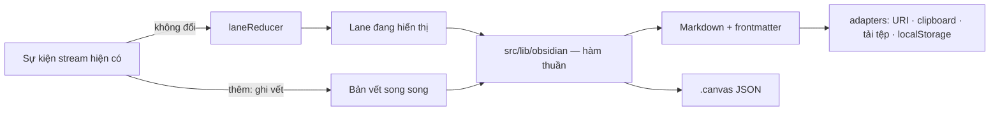

# 01 — Hiện trạng (`origin/main @ 3f640830`) và kiến trúc

## 1. Hiện trạng đã đối chiếu

| Thành phần | Thực tế trên `main` |
|---|---|
| `src/components/elite10/Elite10Hub.tsx` | 5 tab con `board / profile / ai / evidence / risk`. Tab `ai` render `EliteAiRoom`. Có **keep-alive**: sau lần mở đầu (`aiOpened`), phòng họp chỉ bị ẩn (`hidden`) khi đổi tab con, nên kết quả còn nguyên |
| `src/components/MainTabs/MainTabs.tsx` | Tab chính render có điều kiện. **Rời tab QUYẾT ĐỊNH là gỡ toàn bộ phòng họp**: tranh luận đang chạy bị huỷ, kết quả chưa xuất bị mất |
| `src/components/elite10/center/EliteAiRoom.tsx` | State `subject, bull, bear, judge, brief, phase, briefBusy`. `phase` có 4 giá trị `idle / arguing / judging / done`; bấm Dừng vẫn về `done` |
| Tranh luận | Gọi song song `run("claude","bull")` và `run("gemini","bear")`, sau đó `run("claude","judge")`. Trọng tài nhận mỗi phe tối đa `JUDGE_MAX = 6000` ký tự, phần thừa bị thay bằng `…[cắt bớt]`. Nếu cả hai phe đều rỗng thì **không có trọng tài**. Mỗi lần tranh luận tốn **3 câu** hạn mức |
| Câu lệnh | `debateQuestions()`: kỳ hạn "5–10 phiên"; câu lệnh bản tin không có vai trò |
| Mã chủ đề | Chỉ kiểm theo mẫu `^[A-Z0-9]{3,10}$`, nên một chuỗi khớp mẫu chưa chắc là mã thật |
| `CatalystChatPanel.tsx` (dùng chung với tab Chat xúc tác) | `turns`, `input`, `busy`, `mode` (`claude / gemini / compare`) và `meta = { remaining, macroMode, worldMode }`. `meta` là **của lượt cuối**, không lưu theo từng lượt |
| `laneReducer` | Giữ: `model`, `text`, `notices`, `tools{id,name,result}`, `untraceable`, `error`, `done`, `fallback`. **Bỏ qua:** `meta.host / macroMode / worldMode / remaining`, `tool_call.input`, `done.stopReason / rounds`, cùng mọi mốc thời gian |
| `services/catalystChat.ts` | `POST {Gateway}/api/catalysts/chat`. Khi Gateway trả 503 thì gọi Project A. SSE gồm `meta / text / tool_call / tool_result / notice / audit / done / error` |
| Nhãn model | Nhãn cố định ("Phe mua · Claude"…) cộng thêm `lane.model`. Khi `fallback = true`, tên nhà cung cấp trong nhãn có thể không phải mô hình đã trả lời |
| Mẫu có sẵn để dùng lại | `downloadText(name, text, type)` ở `src/lib/kqkd/format.ts` (Blob + thu hồi URL sau 1 s) · `navigator.clipboard.writeText` ở `EliteScreener.tsx` · `showToast` ở `src/store/useAppStore.ts` · lịch giao dịch Việt Nam thuần, không I/O: `makeVnTradingCalendar` ở `src/lib/cotuc/vn-trading-calendar.ts` |
| Liên kết sâu | `?tab=quyet-dinh` chạy được (`MainTabs`). Tab con **không** có URL riêng |
| CSP / header | `vercel.json` chỉ có header cache, nên không có gì chặn `obsidian://` |

**Đã sửa so với v1.** v1 dẫn `src/utils/generateCompareNote.ts` và "Clipboard trong AI Chart Vision" làm mẫu tham khảo. Cả hai **không còn trên `main`**: tệp thứ nhất bị xoá ở `376fbf54`.

## 2. Dữ liệu công cụ có cấu trúc dùng được (allowlist)

| Công cụ | Trường dùng | Mục đích |
|---|---|---|
| `elite_decision` | `data.date`, `data.portfolioKind`, `data.hl.cashPct`, `data.portfolio[].{ticker, sectorIcb, weightPct, hlRank, sectorRrg, close, returnSinceEntryPct}` | `data_as_of`, bối cảnh Nhật ký, wikilink mã/ngành |
| `elite_ticker` | `data.ticker`, `data.date`, `data.icb.{l1,l2,l3}`, `data.elite.{rank, inPortfolio}` | Xác nhận mã, ngành, `data_as_of` |
| `macro_*`, `world_*`, `ws_*`, `catalyst_*`, `elite_evidence` | chỉ `name` + `result.ok` | Wikilink chủ đề vĩ mô / thế giới; liệt kê bằng chứng |

Mọi trường khác **không** được đưa vào ghi chú. Ghi chú ghi rõ: "đã lược bỏ dữ liệu thô của công cụ".

## 3. Kiến trúc

1. **Bản vết song song (trace).** Trong hàm nhận sự kiện của `EliteAiRoom`, ghi thêm `startedAt`, `finishedAt`, `meta.host`, `meta.macroMode`, `meta.worldMode`, `tool_call.{id, name, input đã rút gọn}`, `done.stopReason / rounds`. Sau đó vẫn gọi `laneReducer` **y như cũ**.
2. **Builder thuần** (`src/lib/obsidian/*`): không dùng `window`, mạng hay storage; nhận `now` và lịch giao dịch làm tham số.
3. **Adapter** (`src/lib/obsidian/adapters.ts`): chỉ chạy sau cú bấm. Mỗi thao tác trả một kết quả có tên rõ ràng.
4. **Giao diện** (`src/components/elite10/center/obsidian/*`): hiển thị và điều phối, không phân tích lại nội dung AI.

## 4. Phạm vi tệp (allowlist)

| Tệp | Loại |
|---|---|
| `src/lib/obsidian/{yaml,note,entities,uri,canvas,vaultKit,review,adapters,types}.ts` | **Mới** (PR O1) |
| `src/lib/obsidian/*.test.ts` | **Mới** (PR O1) |
| `src/components/elite10/center/obsidian/*.tsx` + test | **Mới** (O2, O3) |
| `src/components/elite10/center/EliteAiRoom.tsx` | **Chỉ thêm** (O2): state `trace`, thanh Obsidian, 2 menu Lưu. Dòng nhận sự kiện được **bọc**, không bị bỏ |
| `src/components/MainTabs/ChatXucTac/CatalystChatPanel.tsx` | **Chỉ thêm** (O3): 5 dòng đọc **React context** `QaTapContext` (`src/lib/obsidian/qaTap.ts`) và báo `turns` + `meta` cho Phòng họp AI. Dùng context thay cho 2 prop tuỳ chọn trong v2 nháp, vì thêm prop buộc phải **sửa** dòng khai báo hàm. Không có Provider (tab Chat xúc tác) thì giá trị là `null` và không làm gì |
| `docs/obsidian-elite-ai-room/*.md` | Tài liệu (v2) |

**Ngoài phạm vi:** backend, Gateway, API, `services/*`, `laneReducer`, `LaneView`, câu lệnh gửi AI, `Elite10Hub.tsx`, các tab khác, cấu hình, các tệp Timeline đang khoá (F0).

## 5. Riêng tư và an toàn
- Ghi chú chỉ được tạo khi người dùng bấm. `localStorage` chỉ lưu: tên/ID Vault, thư mục, và 3 công tắc xem trước. **Không** lưu nội dung ghi chú.
- Không đưa token, khoá hay `Authorization` vào ghi chú. Đầu vào công cụ trong bản vết được rút gọn còn tối đa 200 ký tự, và chỉ giữ các khoá dạng văn bản hoặc số.
- Câu hỏi của người dùng có nằm trong ghi chú Hỏi đáp. Có công tắc "Gồm câu hỏi của tôi" (mặc định bật).
- Không ghi nội dung ghi chú ra console.
