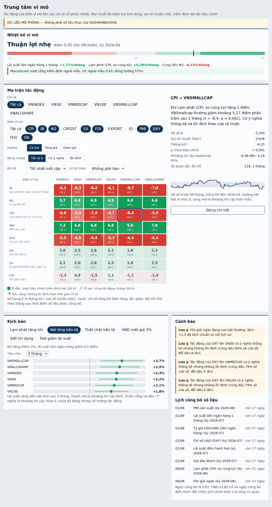

# Trung tâm vĩ mô (macro-center)

Phân tích tác động của biến vĩ mô lên các chỉ số cổ phiếu HOSE. Xuất phát từ bài báo "Sự tác động của các nhân tố kinh tế vĩ mô đến các chỉ số giá cổ phiếu tại HOSE" (2015) nhưng sửa các điểm yếu phương pháp của bài: chuỗi không dừng, sai số chuẩn OLS thường, không hiệu chỉnh kiểm định bội, không xét độ trễ công bố.



## Chạy thử trong 3 lệnh

```bash
npm install
npm test                 # 131 test
npm run serve:demo       # API với dữ liệu MÔ PHỎNG tại http://127.0.0.1:8787/api/macro/health
```

Yêu cầu: Node ≥ 22.5 (kho SQLite dùng `node:sqlite`), React 19 cho giao diện.

## Dùng dữ liệu thật

```bash
npm run import -- --series CPI --file cpi.csv --locale vi     # lặp lại cho từng chuỗi
npm run serve                                                  # đọc macro.db
npm run report -- --out bao-cao-07-2026.md                     # báo cáo tháng (Markdown)
```

`samples/` có CSV mô phỏng đúng định dạng (dấu phẩy thập phân, kỳ `YYYY-MM`) để thử luồng nạp. Danh mục chuỗi, độ trễ công bố mặc định: `src/macro-data.ts` (cần đối chiếu từng nguồn).

## Cấu trúc

| Thư mục/file | Vai trò |
|---|---|
| `src/quant-macro.ts` | Lõi thống kê: kiểm định nghiệm đơn vị, OLS/HAC, FDR, ma trận tác động, MacroScore |
| `src/macro-data.ts`, `macro-store-sqlite.ts`, `macro-import.ts` | Danh mục, kho vintage (bộ nhớ và SQLite), ETL, kiểm tra chất lượng |
| `src/macro-regime.ts` | HMM và độ nhạy theo chế độ |
| `src/macro-scenario.ts`, `macro-backtest.ts`, `macro-report.ts` | Kịch bản, cảnh báo, lịch, backtest, báo cáo |
| `src/macro-api.ts`, `macro-http.ts`, `macro-client.ts` | API không phụ thuộc framework, adapter HTTP, client |
| `src/macro-chat-tools.ts` | Công cụ cho tab chat (6 tool LLM, bộ thực thi, system prompt) |
| `src/macro-filter.ts`, `src/ui/*` | Mô hình hiển thị, thành phần React, CSS |
| `python/macro_service.py` | Johansen/VECM (bản nháp, chưa chạy) |
| `docs/HANDOFF-macro-P0-P5.md` | Bàn giao chi tiết, giới hạn, việc nên làm tiếp |
| `docs/INTEGRATION-chat-xuc-tac.md` | Bàn giao cho AI tích hợp vào tab chat "xúc tác" |
| `docs/INTEGRATION-tab-xuc-tac.md` | Hướng dẫn cho AI lập trình tích hợp vào tab chat "xúc tác" (khảo sát, công cụ cho chat, thẻ giàu nội dung, kiểm thử, triển khai) |

## Nối vào ứng dụng

```ts
// Backend: bất kỳ framework nào
const api = createMacroApi({ store, today: () => new Date().toISOString().slice(0, 10) });
app.all('/api/macro/*', async (req, res) => {
  const out = await api.handle({ method: req.method, path: req.path, query: req.query as Record<string, string>, body: req.body });
  res.status(out.status).json(out.body);
});

// Frontend (React + Vite)
import './ui/macro-center.css';
<MacroCenterTab baseUrl="" />
```

**API chưa có xác thực hay giới hạn tần suất.** Đặt sau lớp xác thực của ứng dụng trước khi mở ra ngoài.

## Nguyên tắc dùng kết quả

- Ô sọc trong ma trận là "chưa đủ bằng chứng", không phải "không có tác động".
- Chỉ đưa `MacroScore` vào bộ máy quyết định khi API trả `usableForDecisions: true`.
- Ngày công bố trên lịch là ước tính. Dữ liệu demo là mô phỏng và luôn kèm biểu ngữ cảnh báo.

Đọc `docs/HANDOFF-macro-P0-P5.md` để biết đầy đủ những gì chưa được kiểm chứng.
